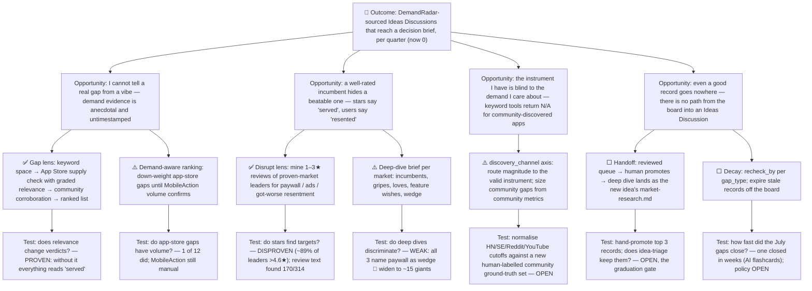

# Opportunity–Solution Tree — DemandRadar

<!--
Teresa Torres's opportunity-solution-tree, rendered as Mermaid (GitHub renders it
natively — no whiteboard tool needed). Structure: one desired OUTCOME → the
OPPORTUNITY space (customer needs/pains) → the SOLUTION space → ASSUMPTION tests.
A living document — revisit as you learn. Owner: Mary (Analyst).
-->

- **Slug:** `demand-radar`
- **Last updated:** 2026-10-19

Legend: ✅ built and tested by the spike · ⚠️ built, calibration open · ⬜ not built.

## Notes

- **Outcome is a metric, not a feature.** The spike optimised the solution space (lenses,
  ranking, dashboard) and never moved the outcome: no record has been promoted in the ~9
  days since the spike merged (2026-10-10). `OPP4` is where the next effort belongs; see `brief.md` §7.
- **The opportunity space was widened by running it.** `OPP2` (resentment behind good
  ratings) and `OPP3` (instrument blindness) were not in the original concept; they came
  out of the July passes and the October spike respectively.
- Each solution bottoms out in the cheapest test that could invalidate it; the table in
  `brief.md` §6 carries the same tests with their results.
